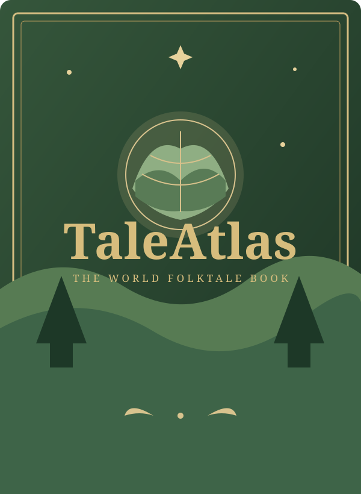

  

  # TaleAtlas

  **A world of folktales, gathered one story at a time.**

  Explore traditional stories from around the world in a quiet, illustrated storybook experience.

  [**Open TaleAtlas**](https://melvinvarghese.github.io/TaleAtlas/)

---

## About

TaleAtlas is a free, browser-based collection of folktales and traditional stories. It presents fresh, child-friendly retellings in a digital book format, designed for curious readers on phones and computers.

The collection currently contains **112 stories across five broad regions**.

## Explore

- **Read like a book** — browse a contents page and turn through two-page story spreads.
- **Discover stories** — explore story cards and browse by region.
- **Find a tale** — search by title, place, or theme.
- **Read anywhere** — responsive layout for desktop and mobile.
- **No account required** — the collection runs directly in your browser.

## Open the library

Visit **[melvinvarghese.github.io/TaleAtlas](https://melvinvarghese.github.io/TaleAtlas/)** to start reading. No installation or sign-up is needed.

## How it works

TaleAtlas is a lightweight static website built with:

- HTML for the page structure
- CSS for the book-inspired design and page-turn effects
- JavaScript for the story collection, search, filters, and reader controls

There is no application server or database. The story collection is included in the repository and loaded in the browser.

## Project files

| File or folder | Purpose |
| --- | --- |
| `index.html` | Main page and reader interface |
| `styles.css` | Layout, typography, and visual design |
| `script.js` | Search, filters, story cards, and page navigation |
| `stories.js` | Folktale content and story details |
| `cover.svg` | Illustrated book cover |
| `assets/` | Supporting visual assets |

## Contributing stories

To add or revise a story, edit the `window.TALEATLAS_STORIES` array in `stories.js`. Follow the structure of an existing entry and give each story a unique `id`.

Please take care when working with traditional stories:

- Folktales often have multiple versions and may be shared across communities.
- Keep retellings in your own words; do not copy modern translations or illustrations without permission.
- Record reliable sources and cultural context when available.
- Avoid presenting one version as the definitive version of a story.

## Run locally

You can open `index.html` in a modern browser. For a more reliable local preview, serve the project folder with a simple local web server, then open the address it provides.

## Project status

TaleAtlas is an evolving personal project. The collection and its cultural notes can be expanded and improved over time.

---

  Made for curious minds and kind hearts.

